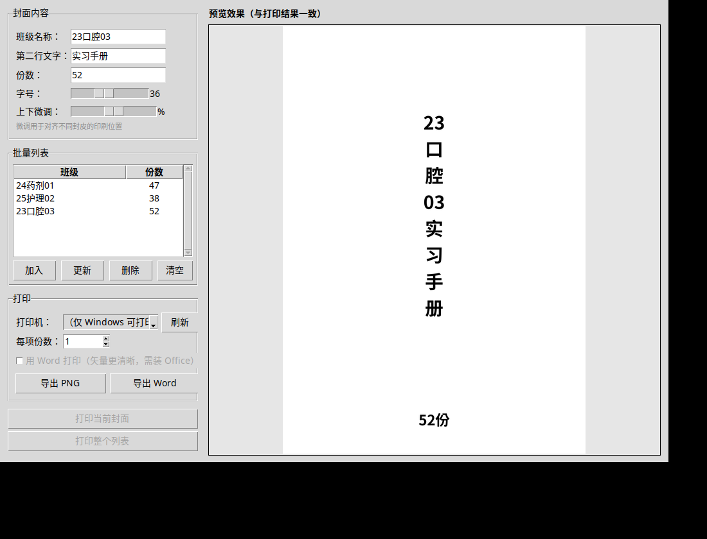
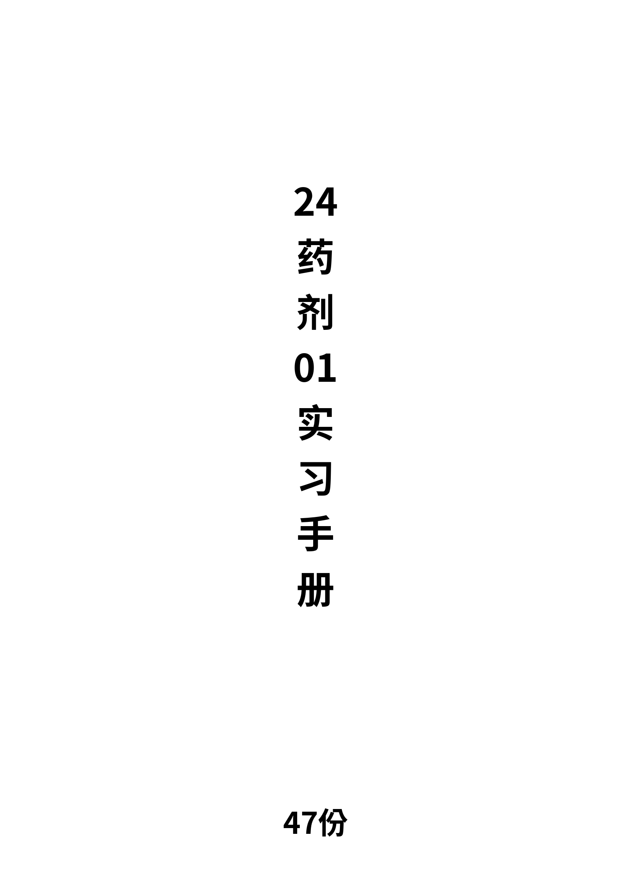
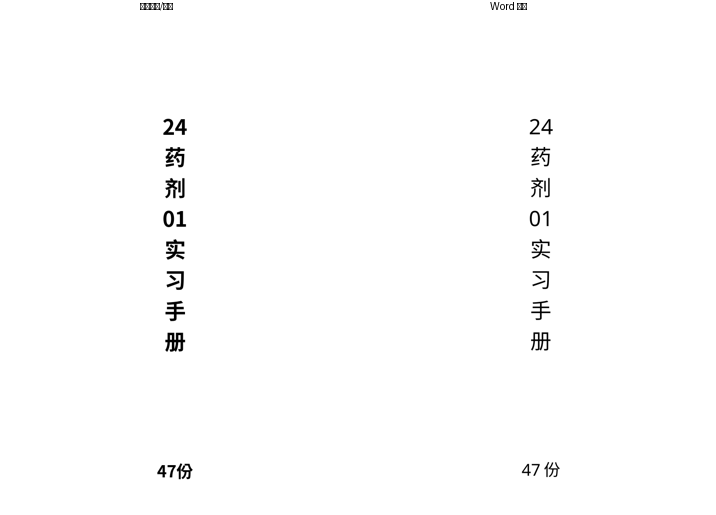
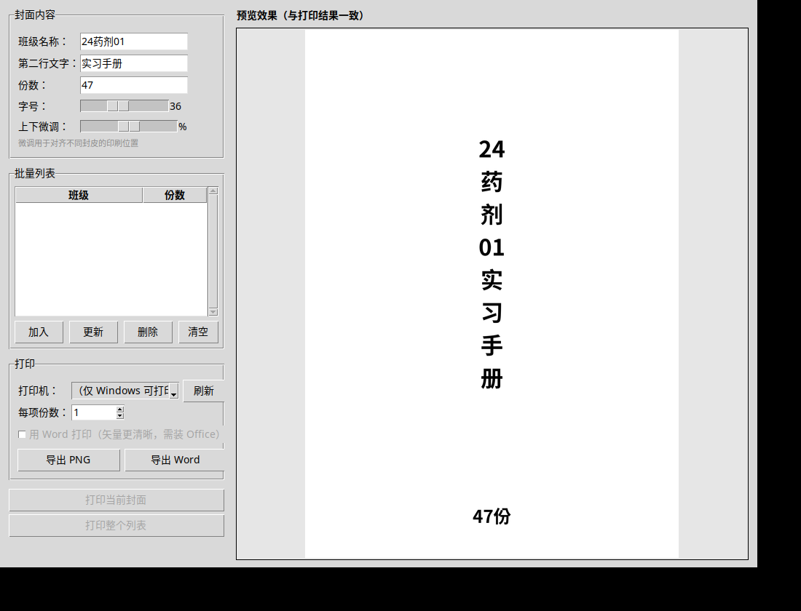

# 实习手册封面生成器

A Windows desktop app for printing A4 Chinese book covers — live preview, pick a printer, hit print. No Word needed.

把原来只能跑命令行的 `make_cover.py`，升级成一个**双击就能用、所见即所得、可直接选打印机打印**的桌面程序。



---

## 为什么做这个

学校每学期要给每个班打印实习手册封面——班级名竖排在 A4 纸中间，底部一行「XX 份」。原来的做法是在 Word 里手动调空段落把文字顶到中间，一个班调一次，几十个班就是一整个下午。

这个程序把这件事变成：填班级名 → 填份数 → 选打印机 → 打印。一个班十秒钟。

---

## 功能

| 能力 | 说明 |
|---|---|
| 实时预览 | 改班级名、份数、字号，预览立刻刷新。**预览 = 打印结果** |
| 直接打印 | 下拉选择系统里的任意一台打印机，点一下就出纸，不用开 Word |
| 批量做 | 列表里存多个班，逐一打印或一次全打 |
| 导出 | 存成 PNG（300dpi 位图）或 Word (.docx) |
| 字号/位置微调 | 字号 20–60 连续可调，上下位置 ±15%，适配不同封皮 |

**关键点：不依赖 Word 就能打印。** 程序自己按打印机原生 DPI 画出 A4 位图，再送进打印机驱动，所以装没装 Office 都能用，字体也不会因为换电脑而变样。

---

## 快速开始

### 一、直接用（不打包）

```bat
pip install pillow python-docx pywin32
python cover_maker.py
```

### 二、打包成 exe

1. 安装 Python 3.9+（<https://www.python.org/downloads/>，安装时**务必勾选 `Add Python to PATH`**）
2. 双击 **`build.bat`**

脚本会自动装依赖、调用 PyInstaller 出包，产物在 `dist\` 目录：

- 选 **1** → 单文件 exe（一个文件，到处拷，推荐）
- 选 **2** → 文件夹版（启动快）

> 打包后的 exe 未经签名，Windows SmartScreen 可能弹一次黄条，
> 点「更多信息 → 仍要运行」即可。也可右键 → 属性 → 勾选「解除锁定」。

---

## 怎么用

1. 填**班级名称**（如 `24药剂01`）和**份数**（如 `47`）
2. 右侧看预览，满意后点**加入**存进列表
3. 换下一个班，重复第 1–2 步
4. 在「打印机」下拉框里选好机器，设好每项份数
5. 点**打印当前封面**或**打印整个列表**

### 小技巧

- 双击列表里的行 → 载入该班参数到预览
- 选中行按 `Delete` → 删除
- `Ctrl+Enter` → 快速打印当前封面
- 列表和上次输入会自动记住，下次打开还在

### 打印质量

默认走**位图打印**（不需要 Office，跨电脑效果一致）。
如果本机装了 Microsoft Word，勾选「用 Word 打印」可获得**矢量文字**，质量更高，代价是慢一点、依赖本机字体。



---

## 命令行模式（兼容原脚本）

```bat
python cover_maker.py 24药剂01 47            :: 生成 docx
python cover_maker.py 24药剂01 47 out.docx   :: 指定输出文件名
python cover_maker.py                        :: 不带参数 = 打开图形界面
```

---

## 排版对照

位图打印版与 Word 导出版逐行对齐，差异在 1–2mm 内，打印以预览为准。





---

## 目录结构

```
cover_maker/
├── cover_maker.py      主程序（GUI + 排版 + 打印）
├── build.bat           Windows 一键打包脚本
├── requirements.txt    依赖清单
├── 使用说明.md         完整说明文档
├── 界面截图.png        主界面
├── 封面效果示例.png    生成的封面样张
├── 排版对比.png        位图打印版 vs Word 导出版 对照
└── 打包版验证.png      打包成单文件 exe 后的实际运行画面
```

---

## 常见问题

**Q：打印机下拉框是空的 / 刷新不出来？**
A：确认打印机已安装并连接（Windows「设置 → 蓝牙和设备 → 打印机和扫描仪」里能看到）。虚拟打印机（如 Microsoft Print to PDF）也能选。

**Q：打印出来是空白页？**
A：多半选成了「另存为 PDF」类虚拟打印机，且弹出保存对话框后没选路径。换一台实体打印机试试。

**Q：文字显示成方块 □？**
A：系统缺中文字体。Windows 自带黑体（simhei.ttf）正常都有；若被精简过，把一个 `simhei.ttf` 放到 exe 同目录即可。

**Q：文字太多超出页面？**
A：界面会提示「内容超出页面」，把字号调小即可。

---

## 技术说明

- 排版按 A4 物理尺寸（210×297mm）计算，竖排文字块居中，底部「XX 份」独立定位
- 位图打印走 `PIL.ImageWin.Dib` + 打印机 DC，分辨率跟随打印机原生 DPI（上限 600）
- Word 导出用精确行距 + 段前距定位，避免用空段落撑位置导致的跨页溢出
- 打包注意：Pillow 10+ 的 PyInstaller hook 会排除 tkinter，导致 `PIL.ImageTk` 漏打、exe 预览空白。程序改用 tkinter 原生 `PhotoImage` 绕开

---

## License

MIT
